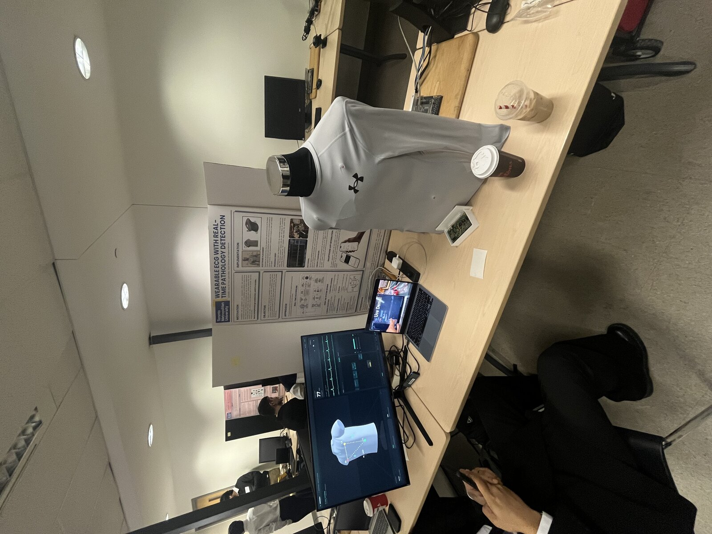
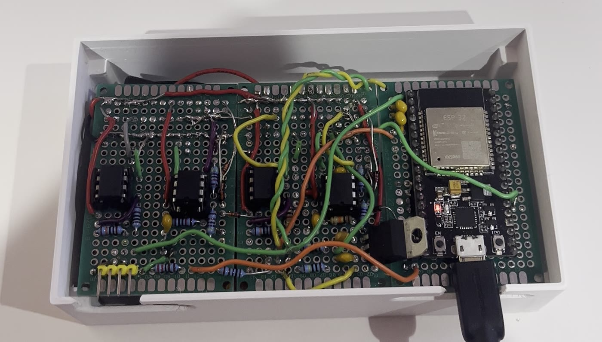
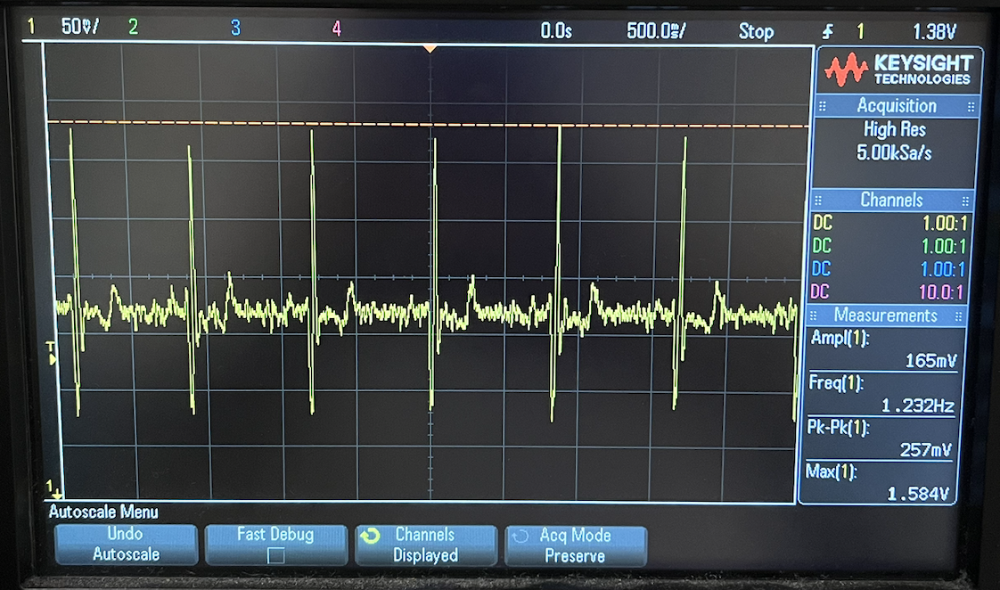
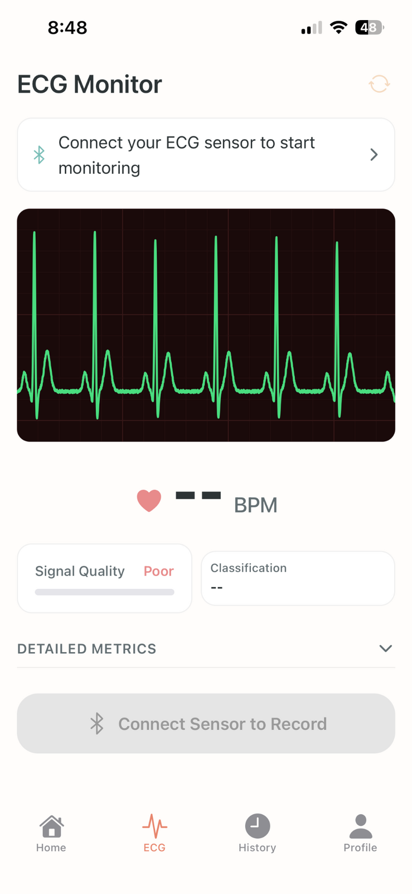

# ecg-compression-shirt

A garment-integrated wearable ECG with two acquisition channels and three derived leads. It streams over Bluetooth Low Energy to a phone app that labels each beat as Normal, PVC or PAC. Biomedical Engineering capstone (RP02), Toronto Metropolitan University, 2026.

| | |
|---|---|
|  |  |
| Capstone expo: shirt on mannequin, enclosure, live dashboard | Two analog channels and the ESP32 in the printed enclosure |
|  |  |
| On-body ECG at the ADC node: 257 mVpp, 74 bpm | Phone app, ECG monitor screen |

This repository is the engineering record of the build. It covers:
- the analog front-end and the five hardware iterations, including what broke each one;
- the hand-drawn schematic and layout, with a design review;
- the BLE and app pipeline;
- the classifier, including an audit of its training data;
- the measured results, and the limits that were not solved.

Two scripts recompute every number from first principles:
- [`analysis/design_checks.py`](analysis/design_checks.py) checks the hardware, link and BOM figures.
- [`analysis/ml_check.py`](analysis/ml_check.py) checks the classifier output.

Where the submitted report disagrees with the arithmetic or with the source material, [docs/ERRATA.md](docs/ERRATA.md) says so.

**Status:** working proof of concept, hand-soldered on perfboard. Not a medical device. Not validated against annotated clinical recordings.

---

## Architecture

```
 Electrodes RA, LA, LL (+ RL ground reference), dry Ag/AgCl, Mason–Likar torso sites, held by compression shirt
     │  47 kΩ series per input (fault current ≤ 191 µA)
     ▼
 AD620 ×2 — G = 5.94 (RG = 10 kΩ), REF = GND       ch1: RA − LA = −Lead I    ch2: RA − LL = −Lead II
     ▼                                              (low gain so electrode DC offset cannot saturate it)
 AC coupling → LM358 inverting, G = −100 (100 kΩ / 1 kΩ)   → +Lead I, +Lead II   total |G| ≈ 594
     ▼
 10 µF → 1 MΩ / 1 MΩ bias from 3.3 V → 1.65 V  (schematic + scope; the report's 2.5 V is wrong)
     ▼
 ESP32-WROOM-32 DevKit — GPIO 34 / 35, 12-bit, 16× oversampled to 360 Hz,
                         moving-average 60 Hz null, digital baseline high-pass, Lead III = II − I
     ▼  BLE GATT: 3 lead characteristics + 1 classification characteristic
 Phone app — Expo SDK 54 · React Native 0.81 · react-native-ble-plx · Skia · Reanimated
     ├─ base64 decode → circular buffer → Skia path on UI thread (60 fps)
     ├─ adaptive-threshold R-peak detector, 200 ms refractory → HR, SDNN, PR, QT
     ├─ pSQI quality gate (score < 50 suppresses beat labels)
     └─ beat label {N, PVC, PAC}

 Offline: dual-input 1D ResNet (500 ms beat window + RR features), MIT-BIH, record-wise split, class-weighted
```

Power: two 9 V alkaline cells (±9 V) mounted under the board stack, an L78xx regulator, and an SPST switch on the positive rail. The enclosure demo runs the ESP32 from USB.

Details:
- [docs/DESIGN.md](docs/DESIGN.md) — derivations.
- [hardware/SCHEMATIC.md](hardware/SCHEMATIC.md) — netlist, review and photos.
- [ml/README.md](ml/README.md) — classifier audit.
- [app/](app/) — app screenshots and architecture figures.
- [firmware/README.md](firmware/README.md) — acquisition firmware.

## Engineering log: what broke and what fixed it

| # | Symptom | Root cause | Fix |
|---|---|---|---|
| 1 | AD620 output a flat line at −8 V with real electrodes; fine with a function generator | 50–80 mV half-cell offset between electrodes × gain 106 = 5.3–8.5 V of DC → saturation | AD620 gain dropped to ≈ 6 (RG 470 Ω → 10 kΩ); remaining gain moved after AC coupling |
| 2 | Clean trace on the scope, but recorded data was mostly noise | Total gain of 60 put the ECG in < 1 % of the ADC span (under 4 effective bits) | LM358 feedback 10 kΩ → 100 kΩ; total gain ≈ 600; SNR ≈ 16 dB → ≈ 24 dB |
| 3 | Bias node collapsed from mid-rail to 30 mV | The LM358's low output impedance overpowered the 1 MΩ divider through a DC path | 10 µF series coupling capacitor |
| 4 | Risk of crosstalk between leads | One shared bias divider would couple the two channels | Independent bias network per channel |
| 5 | TC1262 3.3 V regulator failed moving from breadboard to perfboard | Not isolated | L7806CV with 0.33 µF in and 0.1 µF ‖ 10 µF out |
| 6 | No protection between a fault and the patient | Series resistance only | 1N4148 clamps from each input to both rails, behind the 47 kΩ |
| 7 | Heart rate wrong; 60 Hz still present | Oversampling loop only reached 190 Hz, which also moved the moving-average null from 60 Hz to 31.7 Hz | Timestamped capture, loop fixed, 360 Hz restored |
| 8 | Common-mode noise in the early ±3.3 V design | — | A driven-right-leg stage was designed (`hardware/iterations/`), then dropped when the build moved to ±9 V; RL became a passive ground |
| 9 | Waveform dropped to 35–40 fps during classification | BLE and ML state in one React context | Split contexts; 60 fps held |
| 10 | Trace unusable while walking or exercising | Motion artifact (≈ 1–10 Hz) overlaps the QRS band; dry electrodes shift on the skin | **Not fixed.** The SQI gate hides labels; use is scoped to low movement |

## Results

| Measure | Result | Conditions |
|---|---|---|
| Stage-2 gain (bench, scope) | 100 (14 mVpp → 1.40 Vpp) | ≈ 15 Hz sine |
| ECG at the ADC node (scope) | 257 mVpp, 74 bpm, QRS and T visible | Gel electrodes |
| Recording SNR | 15.8 → 23.8 dB after the gain fix | 3 subject recordings |
| BLE packet loss | 0.00 / 0.01 / 0.12 % | 1 / 5 / 10 m, iPhone 13, 30-min sessions |
| BLE one-way latency | 5.2 / 5.8 / 7.1 ms | GPIO toggle vs. callback timestamp |
| Decode fidelity (Pearson r) | ≥ 0.9993 | ESP32 serial log vs. phone |
| Render rate | 60 fps | iPhone 13 |
| PVC, test (ResNet) | **P 92.1 % / R 97.1 %** | 1,747 beats, 8 unseen MIT-BIH patients |
| Normal, test (ResNet) | P 86.9 % / R 96.0 % | Same |
| PAC, test (ResNet) | P 16.7 % / R 4.9 % | 82 % of test PACs from one patient (record 232) |
| Battery life | ≈ 4.6 h (+9 V cell) | 109 mA, 500 mAh alkaline |

Full tables: [docs/RESULTS.md](docs/RESULTS.md).

## Known limitations

- **PAC detection does not generalize.** The ResNet catches 4.9 % of PACs in unseen patients. Most test PACs come from one patient (record 232) whose morphology the model never saw. The earlier baseline used the wrong MIT-BIH label (`a` instead of `A`). See [ml/README.md](ml/README.md).
- **On-body classification is untested.** The three recordings were sampled at ≈ 190 Hz but fed to a 360 Hz model. The script also picked each recording's polarity to maximize the Normal score, so the "all Normal" result was built in.
- **Which model the app ran is unconfirmed** (ResNet in the report, logistic regression in the ML owner's summary).
- **Analog filtering doesn't match the documentation.** As drawn, the input coupling gives a ≈ 1.6 kHz high-pass, and the low-pass RC hangs off the op-amp output, where it filters nothing. The working board must differ from the drawing. Analog band-limiting is unconfirmed; see [hardware/SCHEMATIC.md](hardware/SCHEMATIC.md).
- **The 60 Hz filter is a moving average.** It nulls 60 Hz but is −3 dB at about 27 Hz.
- **No clinical validation.** On-body recordings came from three healthy, unannotated subjects. Getting "mostly Normal" on them is not an accuracy figure.
- **Motion kills the signal.** Sitting, desk work and sleep only.
- **Battery life is hours.** The ESP32 draws about 100 mA through the +9 V cell. Multi-day wear needs a separate Li-Po and BLE light sleep.
- **No right-leg drive.** RL is a passive ground reference.
- **Frontal plane only.** Two acquired leads, Lead III derived, no V1. Bundle-branch morphology and PVC origin cannot be resolved.

## Repository layout

```
.
├── README.md
├── docs/
│   ├── DESIGN.md              # Derivations: lead system, AFE, power, BLE, app, classifier
│   ├── RESULTS.md             # Measured results with conditions
│   ├── ERRATA.md              # Report vs. arithmetic vs. source material
│   ├── figures/               # Report figures: placement, casing, shirt, app/BLE/SQI diagrams
│   ├── photos/                # Expo booth
│   └── concept/               # Semester-1 block diagram (12-lead → 5-lead → final)
├── analysis/
│   ├── design_checks.py       # Hardware / link / BOM numbers → PASS / FLAG
│   ├── ml_check.py            # Re-derives labels, split, PAC origin, on-body Fs mismatch
│   └── mitbih_label_audit.py  # Per-record label counts from PhysioNet (needs network)
├── hardware/
│   ├── SCHEMATIC.md           # Netlist, design review, photo gallery
│   ├── schematic_hand.jpg
│   ├── perfboard_layout_channel1.jpg
│   ├── scope/                 # Bench and on-body oscilloscope captures, recordings
│   ├── iterations/            # Multisim figures and earlier designs (incl. RLD)
│   ├── photos/  video/
│   └── bom.csv
├── firmware/README.md         # Acquisition behaviour (code pending)
├── app/                       # Phone app: README + screenshots (code pending)
└── ml/
    ├── README.md              # Classifier audit
    ├── baseline/              # Logistic-regression output
    └── resnet/                # ResNet pipeline log, confusion matrices, on-body inference
```

```bash
python analysis/design_checks.py
python analysis/ml_check.py
```

## Team

Supervised by Robnier Reyes Perez, Department of Electrical, Computer & Biomedical Engineering, TMU. Each member owned one subsystem; integration and testing were shared.

| Member | Owned |
|---|---|
| **Omar Ali-Yare** (A) | Analog front-end: requirements (360 Hz to match MIT-BIH), two-stage AD620/LM358 topology, the bias network, all five board iterations, breadboard-to-perfboard migration, the ESP32 sampling firmware (oversampling, 60 Hz rejection, baseline high-pass, the 190 → 360 Hz fix), and bench and on-body validation |
| Raphael Mancini (B) | ML pipeline: MIT-BIH preprocessing, beat-centred segmentation, logistic-regression baseline, 1D CNN; helped debug the AFE |
| Justin Allen (C) | Wearable: lead reduction, Mason–Likar placement, dry electrodes in the compression shirt, 3D-printed casing |
| Tenzin Dhonyoe (D) | Phone app and BLE pipeline: device discovery, packet handling, live display, end-to-end streaming tests |

Training data: MIT-BIH Arrhythmia Database, PhysioNet (Moody & Mark, 2001; Goldberger et al., 2000).

## License

Not yet chosen. All four authors need to agree on one before code is added.
