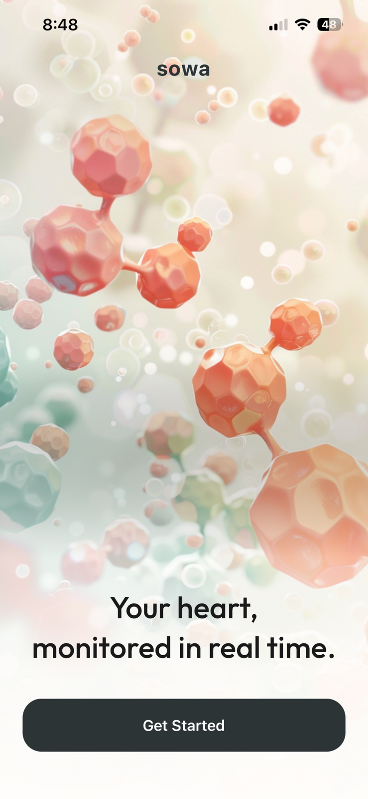
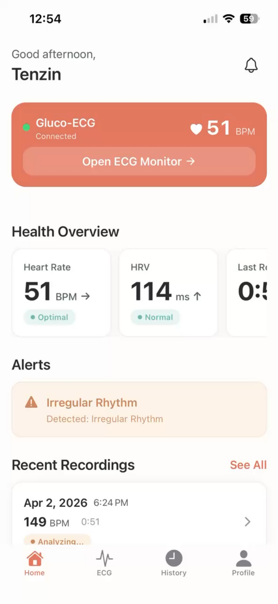
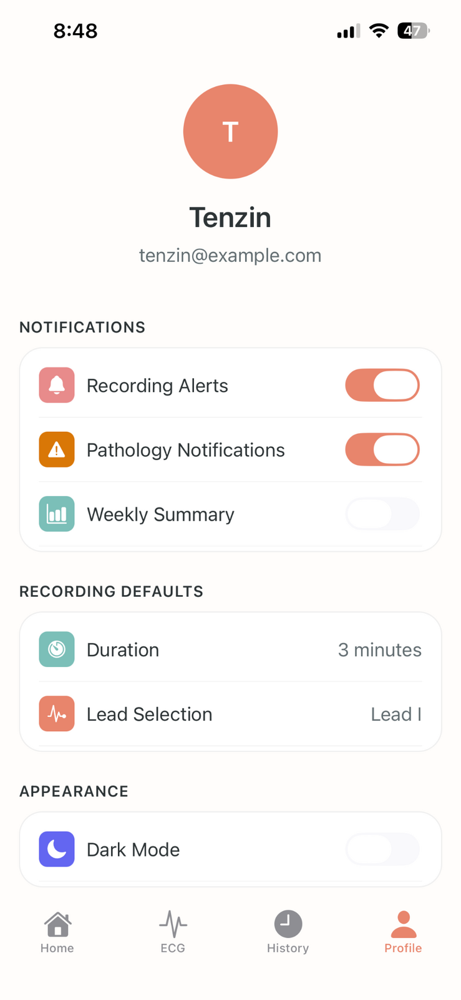
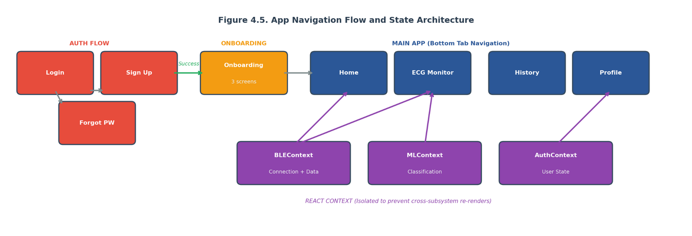
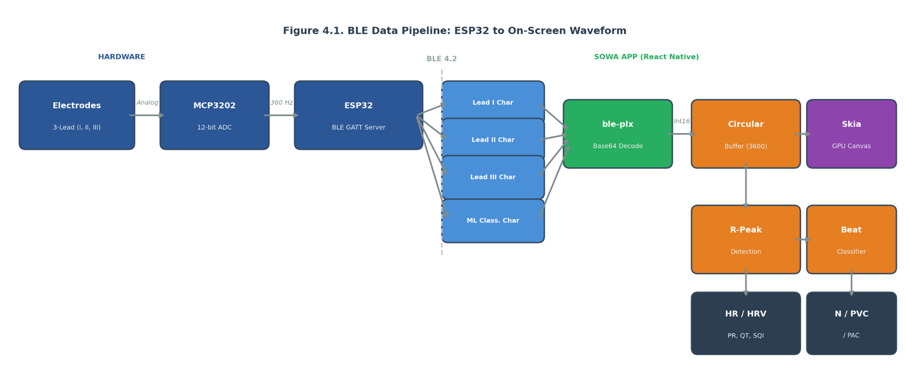
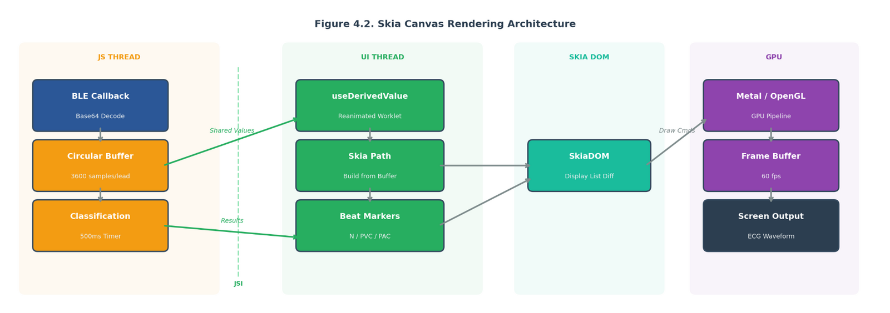
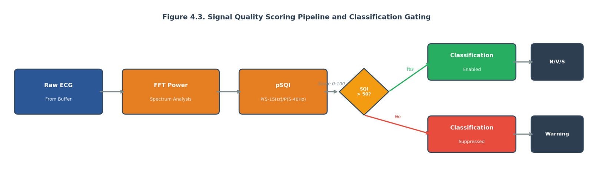

# Phone app ("SOWA")

Owner: Tenzin Dhonyoe (Student D). Expo SDK 54 · React Native 0.81 · React 19 · react-native-ble-plx · @shopify/react-native-skia · react-native-reanimated · expo-router. Distributed to testers through TestFlight. **Source code: pending upload.**

| Welcome | Home | ECG monitor | Profile |
|---|---|---|---|
|  |  |  |  |

Architecture (from the report):

| Navigation and state | BLE pipeline |
|---|---|
|  |  |
| **Skia rendering on the UI thread** | **Signal-quality gate** |
|  |  |

## About `05_ecg_monitor_live_sqi.png`

The report uses this screen to illustrate SQI scoring. It contradicts itself:
- "Signal Quality: Excellent" sits next to "Signal too noisy for AI analysis".
- "Optimal" sits next to "Abnormal Rhythm Detected".
- The trace is a ramp that wraps top to bottom, which is what an out-of-range or mis-scaled input looks like, not an ECG.

Treat it as a UI layout capture. A screen recording of a real on-body trace with a correct quality reading would be much stronger evidence.

Measured link performance (iPhone 13, 30-minute sessions) is in [`../docs/RESULTS.md`](../docs/RESULTS.md) §2.
