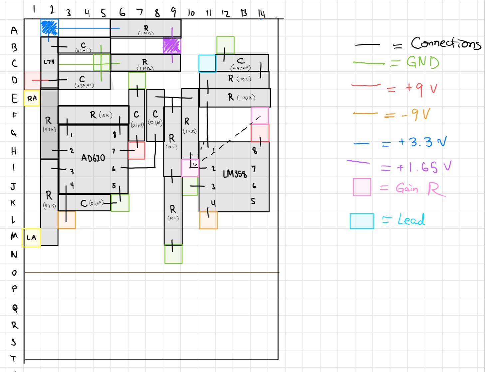
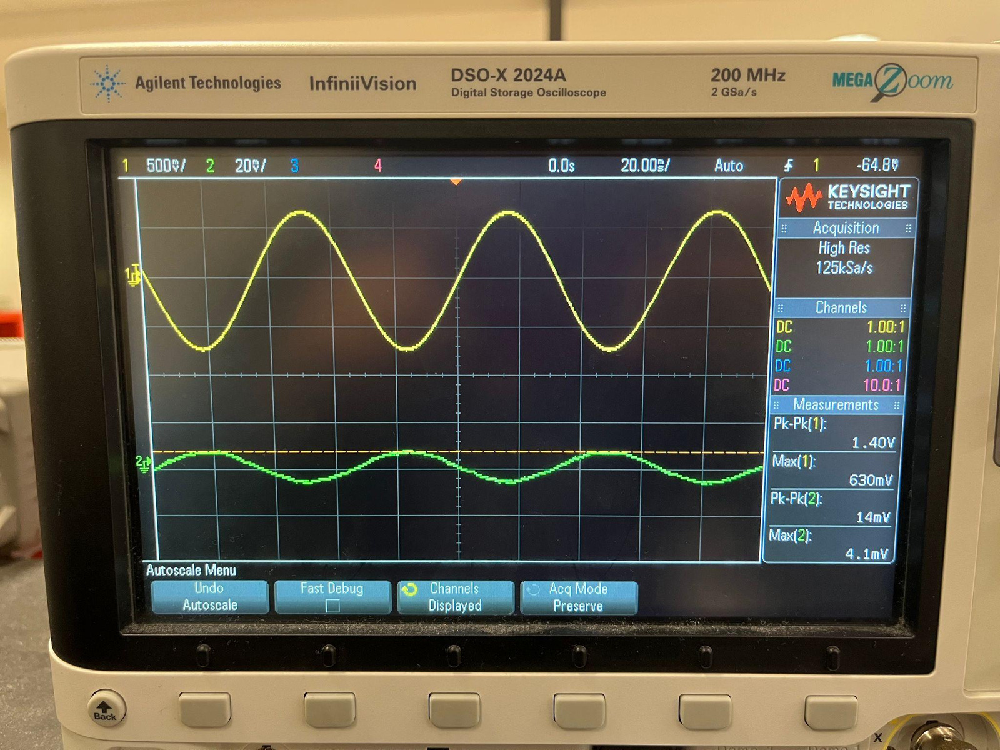
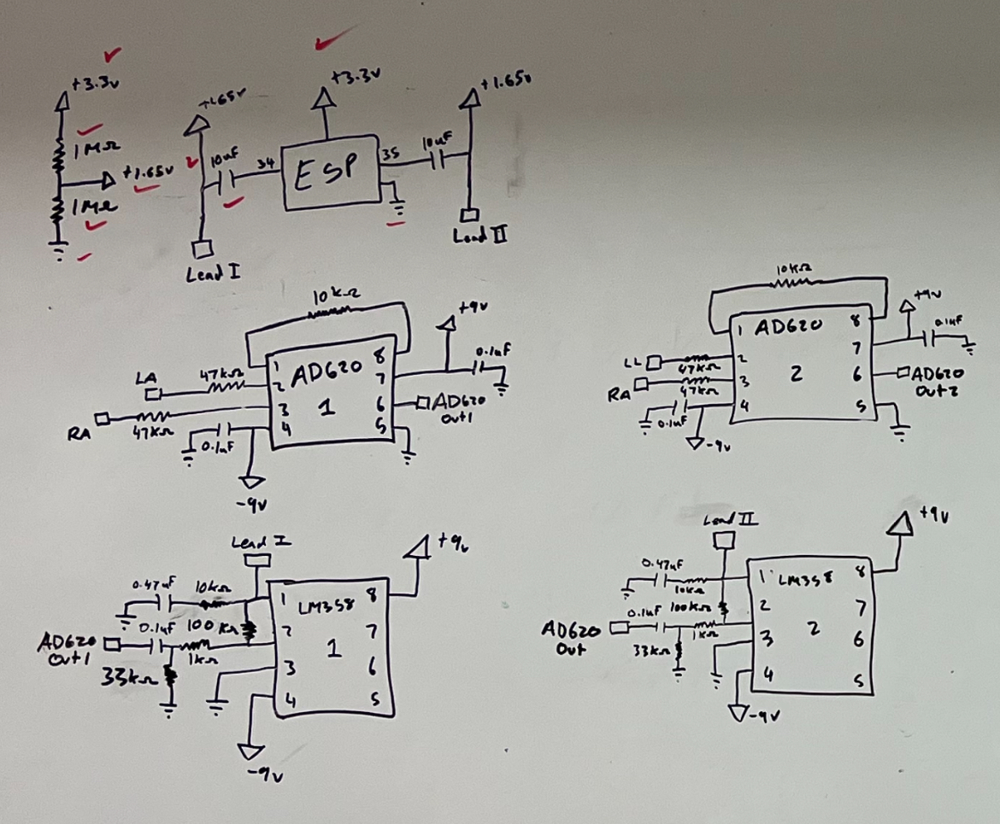
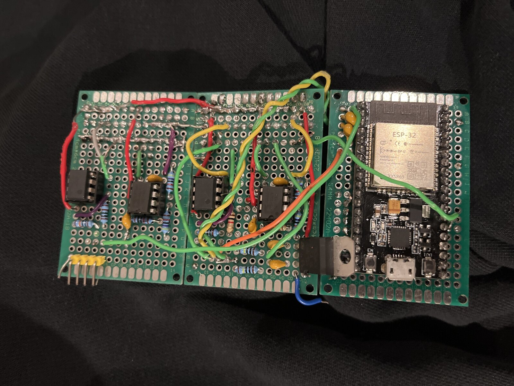
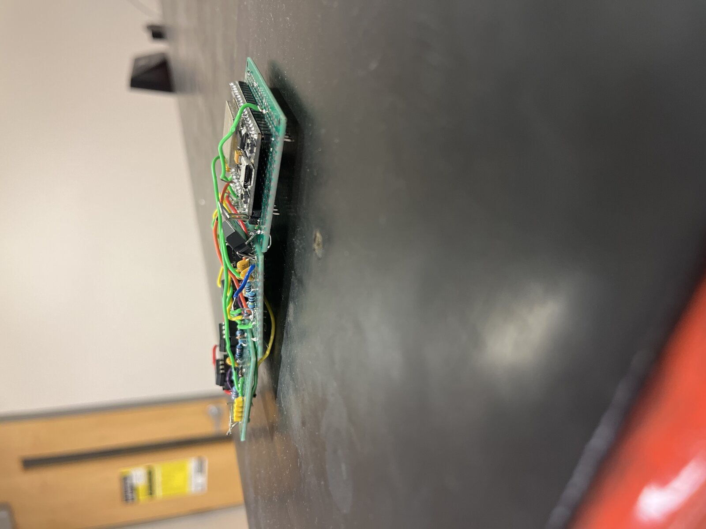
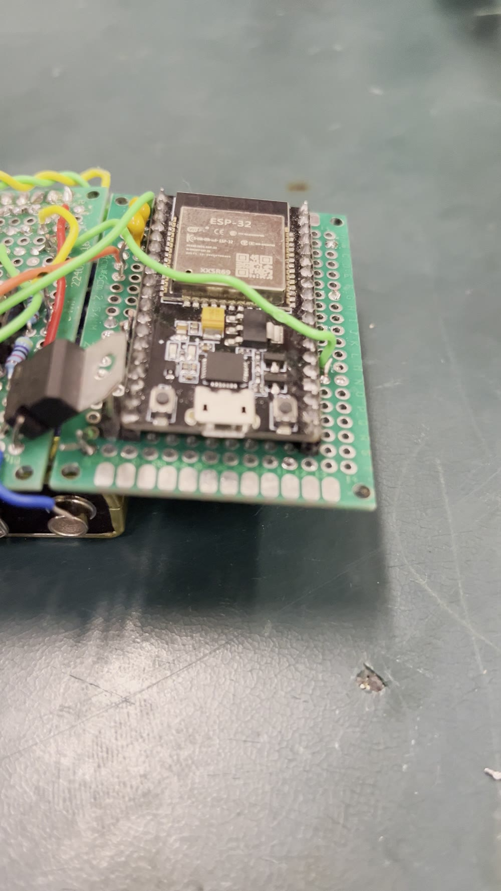

# Schematic and layout review

Sources: the hand-drawn final schematic ([`schematic_hand.jpg`](schematic_hand.jpg)), the hand-drawn perfboard layout for channel 1 ([`perfboard_layout_channel1.jpg`](perfboard_layout_channel1.jpg)), and the photos in [`photos/`](photos/). Where these disagree with the submitted report, both are recorded. Values are reproduced by [`analysis/design_checks.py`](../analysis/design_checks.py).

## Netlist (as drawn)

**Instrumentation amplifiers** (AD620AN, DIP-8, one per channel)

| Pin | Channel 1 (Lead I) | Channel 2 (Lead II) |
|---|---|---|
| 2 (−IN) | LA through 47 kΩ | LL through 47 kΩ |
| 3 (+IN) | RA through 47 kΩ | RA through 47 kΩ |
| 1–8 (RG) | 10 kΩ → G = 5.94 | 10 kΩ |
| 7 (+Vs) | +9 V, 0.1 µF to GND | +9 V, 0.1 µF to GND |
| 4 (−Vs) | −9 V, 0.1 µF to GND | −9 V, 0.1 µF to GND |
| 5 (REF) | GND | GND |
| 6 (OUT) | to LM358 #1 | to LM358 #2 |

**Gain stage** (LM358P, amplifier A only, per channel): AD620 out → 0.1 µF series → node X; X → 33 kΩ → GND; X → 1 kΩ → pin 2 (−); pin 1 → 100 kΩ → pin 2; pin 3 → GND; pin 1 → 10 kΩ → 0.47 µF → GND. Pin 8 +9 V, pin 4 −9 V.

**ADC interface**: +3.3 V → 1 MΩ → 1.65 V node → 1 MΩ → GND. Lead I → 10 µF → GPIO 34; Lead II → 10 µF → GPIO 35. One divider per channel.

**Board** (photos): three 4 × 6 cm double-sided perfboards (channel 1, channel 2, ESP32), ESP32-WROOM-32 DevKit-style board with micro-USB, TO-220 regulator, 4-pin electrode header, twisted signal pairs between boards. Two 9 V alkaline cells mount under the board stack. The casing video shows the ESP32 running from USB during the demo.

## What checks out

- **Lead polarity is correct.** Each AD620 measures RA minus the other electrode, i.e. −Lead I and −Lead II. The inverting LM358 flips it back, so each channel outputs +594 × Lead I and +594 × Lead II. If the inputs had been wired the "obvious" way round, the trace would be upside down.
- **AD620 gain** 1 + 49.4 kΩ / 10 kΩ = 5.94; measured 5.5.
- **LM358 gain** 100 kΩ / 1 kΩ = 100; measured 99.7.
- **Input current limiting** 9 V / 47 kΩ = 191 µA worst case.
- **Decoupling** at every AD620 supply pin.
- **Wiring practice.** Signal runs between boards are twisted pairs.

## Issues, ranked

### 1. The input high-pass, as drawn, blocks the ECG — confidence: high for the arithmetic, moderate for what was actually built

A series capacitor feeding the 1 kΩ input resistor of an inverting stage forms a high-pass whose corner is set by that 1 kΩ (the inverting input is a virtual ground):

f = 1 / (2π × (1 kΩ ‖ 33 kΩ) × 0.1 µF) ≈ **1.64 kHz**

At 1 Hz the stage gain would be about 0.06 instead of 100. The report's version (0.22 µF, "1 MΩ to ground") has the same problem: either the capacitor is in series with the 1 kΩ (corner ≈ 723 Hz) or the RC is a shunt branch that the AD620's low output impedance overrides (no high-pass at all). **No arrangement in either document produces the 0.72 Hz corner the report claims.**

The report's own Multisim figure ([`iterations/fig13_active_bandpass_multisim.png`](iterations/fig13_active_bandpass_multisim.png)) confirms the series topology: C1 0.22 µF in series, R1 1 MΩ to ground, R2 1 kΩ to the inverting input. That gives f ≈ 723 Hz.

The bench capture ([`scope/bench_sine_gain100.jpg`](scope/bench_sine_gain100.jpg)) shows 14 mVpp in and 1.40 Vpp out: gain 100. The period is about 3.4 divisions at 20 ms/div, so the test tone was **≈ 15 Hz, not the 1 Hz the report states**. A 723 Hz high-pass would cut a 15 Hz signal to about gain 2. **The stage that was measured did not have this high-pass in it.** Either the capacitor was much larger than drawn, or it was bypassed and the stage is DC-coupled. **Measure it or read the cap marking.**

The correct fix for a sub-Hz corner is either:
- Rin = 10 kΩ, Rf = 1 MΩ (gain still 100), C = 33 µF (film or non-polar) → 0.48 Hz.
- An integrator from AD620 OUT back to REF (DC servo). This is the standard AD620 ECG approach and also removes the electrode offset at the first stage.

### 2. The 33.9 Hz low-pass may not be in the signal path — confidence: moderate

The drawing takes the lead output at LM358 pin 1, with 10 kΩ + 0.47 µF hanging from pin 1 to ground. Taken there, the RC is just a 10 kΩ load on a low-impedance op-amp output, not a filter. It only filters if the output is taken from the **capacitor node**. The layout puts the "Lead" pad at C11, on the pin-1 side of the 10 kΩ. If that's what was built, the analog chain has **no anti-alias filter**: the bandwidth is set by the LM358 (≈ 1 MHz GBW / 100 ≈ 10 kHz) and by firmware averaging.

### 3. The bias is 1.65 V, not the report's 2.5 V — confidence: moderate-high

| Source | Bias supply | Midpoint |
|---|---|---|
| Hand schematic | +3.3 V | 1.65 V |
| Layout legend | +3.3 V (blue), +1.65 V (purple) | 1.65 V |
| Report §3.2 / iteration 4 | "regulated 5 V from the L7806CV" | 2.5 V |
| Multisim Fig. 14c | +1.65 V rail | 1.65 V |
| On-body scope capture (DC-coupled, 1:1) | — | trace sits ≈ 1.33–1.58 V (Max 1.584 V, 257 mVpp) |

The DevKit's onboard regulator outputs 3.3 V, not 5 V, and the L7806CV outputs 6 V. The DC-coupled scope capture puts the signal around 1.45 V. That fits a 1.65 V bias slightly loaded, and does not fit a 2.5 V bias or a ground-referenced LM358 output. The caption doesn't say which node was probed, which is the remaining uncertainty. **The as-built bias is ≈ 1.65 V, and the report's 2.5 V is wrong.** The swing is therefore about 1.35–1.95 V, inside the ESP32 ADC's linear range at 11 dB attenuation, and the nonlinearity concern in ERRATA C1 does not apply. Correct the report.

### 4. Coupling-cap position in the drawing — confidence: low-moderate

The drawing appears to put the 10 µF between the bias node and the GPIO. That would leave the ADC pin with no DC path: GPIO 34 and 35 are input-only with no internal pulls, so the pin would drift. The Multisim Fig. 14c shows the same arrangement. The report text describes the correct order (LM358 → 10 µF → bias node → GPIO), and the scope capture shows a working DC level, so the board is probably built correctly and both drawings are wrong. Fix the drawings.

### 5. RL is not drawn — confidence: high that it's missing from the drawing

Neither the schematic nor the layout shows the RL electrode. The AD620 input bias current needs a return path, so RL must go to circuit ground (the junction of the two 9 V cells). The 4-pin header in the photos is presumably RA, LA, LL, RL. Add it to the schematic and state plainly that RL is a passive ground reference, not a driven right leg.

### 6. Protection diodes are not drawn — confidence: moderate

The report's iteration 5 adds 1N4148 clamps from each input to both rails. They are not in the schematic or layout. Small glass-body diodes are visible in the casing photo, so they are probably fitted. Add them to the drawing.

### 7. The report's "final circuit" Multisim figures are not the built circuit — confidence: high

The report presents Fig. 14 as the final design. Its panels disagree with the hand schematic, the text and the measurements:

| Panel | What it shows | Conflict |
|---|---|---|
| [`fig14a_ad620_multisim`](iterations/fig14a_ad620_multisim.png) | LA → +IN, RA → −IN (output = +Lead I); 0.1 µF from RA to ground | The hand schematic is the reverse (RA → +IN). Followed by an inverting LM358, Fig. 14a's wiring gives an **upside-down** Lead I. The 0.1 µF on one input only unbalances the input impedance and degrades CMRR. |
| [`fig14b_lm358_multisim`](iterations/fig14b_lm358_multisim.png) | **Non-inverting** LM358, gain 1 + 100k/10k = **11**; pin 8 (V+) tied to **ground**; "Lead I" node not connected to the output | Measured gain is 100 and the stage inverts. With V+ grounded, the op-amp has no positive supply. |
| [`fig14c_esp32_bias_multisim`](iterations/fig14c_esp32_bias_multisim.png) | 1.65 V rail, 10 µF to ESP32 | Same coupling-cap issue as #4 |

Replace Fig. 14 with a clean capture of the hand schematic in the portfolio. Don't present these panels as the final design.

## Scope captures

| | |
|---|---|
|  |  |
| Stage 2 bench test: 14 mVpp in (green, 20 mV/div), 1.40 Vpp out (yellow, 500 mV/div), ≈ 15 Hz. Gain 100. | On-body ECG at the ADC node: 257 mVpp, 1.232 Hz (74 bpm), Max 1.584 V, 50 mV/div, 500 ms/div. Clear QRS and T waves; visible high-frequency noise on the baseline. |

The on-body amplitude is **257 mVpp**; the report says about 550 mVpp. Amplitude varies with electrode placement and subject, so quote 257 mVpp with the capture, or produce the 550 mVpp capture.

[`scope/onbody_ecg_noisy.jpg`](scope/onbody_ecg_noisy.jpg) is an earlier, noisier capture. [`scope/recordings_subject_T_Z_Z2.png`](scope/recordings_subject_T_Z_Z2.png) shows the three ESP32 recordings. **All three were sampled at 190–192 Hz**, not 360 Hz (see `ml/README.md` §3).

## Earlier iterations

| File | What it shows |
|---|---|
| [`early_3v3_with_right_leg_drive.png`](iterations/early_3v3_with_right_leg_drive.png) | ±3.3 V / mid-rail design with a **driven right leg**: LM1 senses common mode through three resistors on LA, RA, LL and drives RL. Two AD620s feed LM358 band-pass stages. |
| [`early_tc1262_single_supply.png`](iterations/early_tc1262_single_supply.png) | TC1262 3.3 V regulator, single supply, 1.65 V virtual ground, AD620 with 220 Ω RG (G ≈ 226) |
| [`early_ad620_lm358_sketch.png`](iterations/early_ad620_lm358_sketch.png), [`early_bandpass_sketch.png`](iterations/early_bandpass_sketch.png) | Gain and filter sketches leading to the ±9 V design |

Right-leg drive was designed and then dropped when the build moved to ±9 V with a grounded RL. That is a legitimate thing to say in an interview ("designed an RLD stage, removed it to simplify the dual-supply build, would restore it for CMRR"). It is not legitimate to list RLD as a feature of the built device.

## Layout

Hand-drawn on a 14 × 20 grid, channel 1 only (RA, LA, AD620, LM358, bias divider, L78xx regulator with 0.33 µF / 0.1 µF decoupling). Rows P–T are unused. Channel 2 is a copy on the second board.

The user reports the circuit was captured in Altium before hand-soldering. Those Altium files are not in this repository yet. Until they are, do not describe this repo as containing an Altium design or PCB.

## Photos

| | |
|---|---|
|  |  |
| Boards in the printed enclosure, USB-powered for the demo | Channel 1 (top), channel 2 (middle), ESP32 + regulator (bottom) |
|  |  |
| Board stack profile | ESP32 board; 9 V cells mount beneath |

Videos (re-encoded to 720p H.264 for size): [`video/casing_and_usb_power.mp4`](video/casing_and_usb_power.mp4), [`video/board_and_9v_mount.mp4`](video/board_and_9v_mount.mp4), [`video/board_walkaround_lowres.mp4`](video/board_walkaround_lowres.mp4).

## Concept history

[`../docs/concept/block_diagram_semester1.jpg`](../docs/concept/block_diagram_semester1.jpg) shows the semester-1 architecture. It compares a 10-electrode / 8-channel 12-lead system with a 5-electrode / 3-channel (I, II, V1) system using a three-op-amp instrumentation amplifier and a twin-T 60 Hz notch. The build was later reduced to 4 electrodes and two channels. The team's stated reason was that V1 was not in the MIT-BIH training data. That reason is wrong: MIT-BIH's second channel is modified V1 in most records (the first is modified lead II). Dropping V1 was a scope choice, not a data constraint.

Note on that sketch: aVR = −(I + II)/2. The minus sign is missing.
